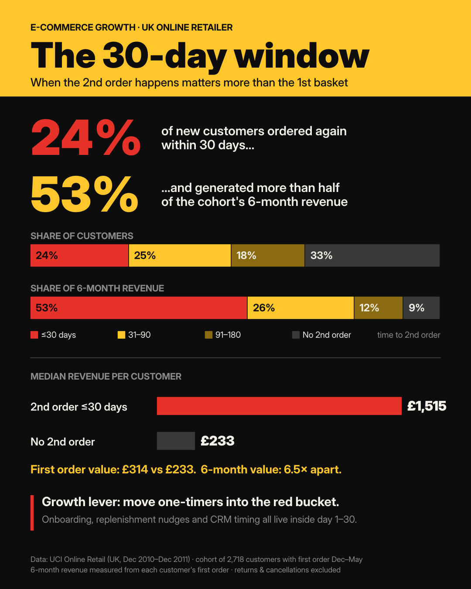

# The 30-day window: time to second order in e-commerce



**Your first order doesn't predict customer value. Your second one does.**

A cohort analysis of a UK online retailer's transactions, asking one question: *what separates a low-value new customer from a high-value one in their first 6 months?*

## Key findings

Cohort: **2,718 customers** whose first order was between Dec 2010 and May 2011, each observed for 6 months.

| Time to 2nd order | Share of customers | Share of 6-month revenue | Median first order | Median 6-month revenue |
|---|---:|---:|---:|---:|
| ≤ 30 days | 23.8% | 52.5% | £314 | £1,515 |
| 31–90 days | 25.2% | 26.5% | £315 | £1,063 |
| 91–180 days | 17.7% | 11.6% | £304 | £694 |
| No 2nd order | 33.3% | 9.3% | £233 | £233 |

- **24% of new customers ordered again within 30 days and generated 53% of the cohort's 6-month revenue.**
- First baskets look similar across repeat segments (£304–£315). The 6-month gap is **6.5×** between the fastest repeaters and one-time buyers.
- Of customers who placed a second order within 6 months, **36%** did so within 30 days, **59%** within 60 days and **73%** within 90 days. Median: **47 days**.

## What this means for growth teams

1. **Track time to 2nd order as a core KPI**, next to first-order AOV.
2. **The CRM window is days 1–30.** Welcome flows, replenishment reminders and post-purchase offers belong there.
3. **Judge acquisition channels by 30-day second-order rate**, not CPA alone.

## Limitations

- **Correlation, not causation.** Fast repeaters may simply be stronger buyers from day one. This analysis shows *where* to experiment; the next step is a controlled test (e.g. a day-14 nudge vs. a holdout group).
- **B2B-heavy customer base.** Many customers are wholesalers, so values are higher than typical B2C.
- **Revenue, not margin.** No cost data is available.
- **One retailer, 2010–2011.** Patterns should be validated on current, category-specific data.

## Method

1. Remove cancellations (`InvoiceNo` starting with `C`), returns (`Quantity ≤ 0`), zero prices and rows without `CustomerID`.
2. Aggregate to order level and number each customer's orders chronologically.
3. Keep customers with a first order before 1 June 2011, so everyone has ≥ 6 months of data.
4. Segment by days between 1st and 2nd order; a 2nd order after day 180 counts as "no 2nd order" within the window.
5. Sum each customer's revenue in the 180 days from their first order.

## Repository structure

```
├── notebooks/time_to_second_order.ipynb   # full analysis, executed
├── src/make_figure.py                     # renders the figure from figures/summary.json
├── figures/30-day-window.png
├── figures/summary.json                   # numbers exported by the notebook
└── data/                                  # put the dataset here (not committed)
```

## Reproduce

```bash
pip install -r requirements.txt
# download the dataset into data/ (see data/README.md)
jupyter nbconvert --to notebook --execute --inplace notebooks/time_to_second_order.ipynb
python src/make_figure.py
```

## Data

Chen, D. (2015). *Online Retail* [Dataset]. UCI Machine Learning Repository. https://doi.org/10.24432/C5BW33 — licensed under CC BY 4.0.

## Author

**Alpay Korkut** · Data Analyst · [LinkedIn](https://www.linkedin.com/in/alpaykorkut)
